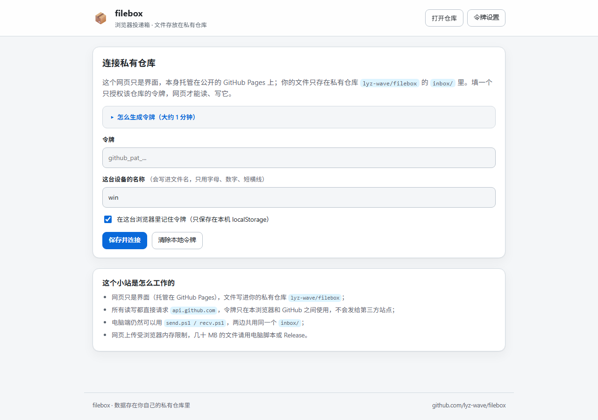
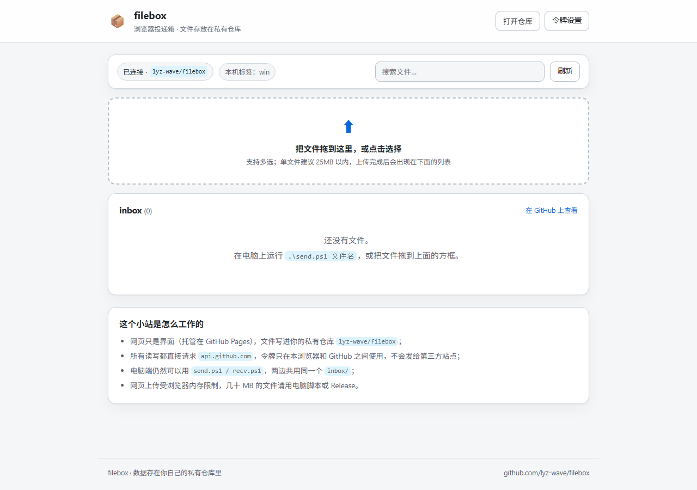
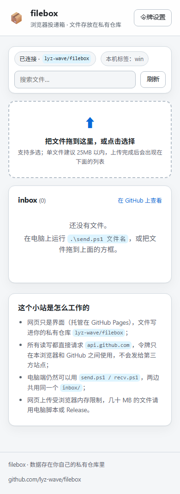

# filebox-web · 网页投递箱

filebox 的浏览器界面：**拖拽上传、发送文字/剪贴板、列表、下载、删除**，数据直接读写私有仓库
[lyz-wave/filebox](https://github.com/lyz-wave/filebox) 的 `inbox/`。

页面地址：**https://lyz-wave.github.io/filebox-web/**

> 这个仓库是公开的，但里面只有界面代码，没有你的文件。文件始终存在私有仓库里，
> 必须填一个只授权该仓库的 GitHub 令牌才能读写。

## 预览







## 在其他设备上启动（推荐让智能体执行）

把这句话复制给那台设备上的智能体：

> 你是本机的配置助手。请读取 https://raw.githubusercontent.com/lyz-wave/filebox-web/main/setup/AGENT.md ，严格按「给智能体的执行流程」把 filebox 配置好；需要 GitHub 授权时把验证码和链接发给我，我完成后再继续。

| 文件 | 用途 |
|---|---|
| `setup/AGENT.md` | 完整启动文档：智能体流程、手动步骤、验收清单、排障 |
| `setup/PROMPT.txt` | 上面那句话的纯文本版 |
| `setup/bootstrap.ps1` | Windows 一键脚本（装 Git / gh、登录、clone、冒烟测试） |
| `setup/bootstrap.sh` | macOS / Linux 一键脚本 |
| `setup/manifest.json` | 机器可读清单（地址、限制、验收命令） |

一键命令（脚本下载到本机后运行）：

```powershell
# Windows
powershell -NoProfile -ExecutionPolicy Bypass -File .\bootstrap.ps1
```

```bash
# macOS / Linux
bash ./bootstrap.sh
```

脚本唯一需要人工的是 GitHub 登录授权：它会打印 8 位验证码和 https://github.com/login/device 链接，浏览器里点一次 Authorize 即可；已经登录过的设备会自动跳过。

## 第一次使用

1. 打开页面，点右上角「令牌设置」；
2. 生成一个 **Fine-grained PAT**：Resource owner 选 `lyz-wave`，
   Repository access 选 Only select repositories → `lyz-wave/filebox`，
   Repository permissions 里把 **Contents** 设为 **Read and write**；
3. 把令牌和这台设备的名称（会写进文件名，比如 `ipad`）填进去，点「保存并连接」。

令牌默认只保存在本机浏览器 localStorage；不想保存就取消「记住令牌」，刷新后重填。

## 发送文字 / 剪贴板

页面顶部有「发送文字 / 剪贴板」输入框：粘贴网址、口令、验证码、一段备忘，点「发送文字」（Ctrl+Enter 也可以）。
内容会保存成 `inbox/` 里的 `.txt` 文件（文件名带时间戳和设备名）；列表里 💬 图标的就是文字，点「查看」看全文，点「复制」直接进剪贴板。

电脑命令行也可以发文字：` .\text.ps1 "文字"`（Windows）/ ` ./text.sh "文字"`（macOS/Linux）。

## 安全说明

- 页面是公开的静态页面，不含任何文件数据；
- 上传 / 下载 / 删除都直接请求 `api.github.com`，令牌只在这一处使用；
- 没有第三方脚本、CDN 或统计，CSP 只允许本站脚本与 api.github.com；
- 令牌只覆盖 filebox 仓库的 Contents 权限，可随时在 GitHub 设置里吊销；
- 页面带 `noindex`，不会被搜索引擎收录。

## 限制

- 文字同样存成文件、走 Contents API；超长文字（几十万字）建议拆段；
- 单文件建议 25MB 以内，页面硬上限 50MB（浏览器内存 + Contents API）；
- 可以一次选多个文件，会按顺序上传，文件名自动加上时间戳和设备名；
- 删除只影响当前版本，git 历史仍保留（和 `clean.ps1` 一致）；
- 超过 100MB 的文件请用电脑端脚本 / Release / LFS。

## 本地预览

```bash
python -m http.server 8080
# 浏览器打开 http://127.0.0.1:8080/
```

不要在浏览器里直接双击打开 `index.html`（file:// 下跨域与 CSP 行为不一致）。

## 文件

- `index.html` — 页面结构
- `style.css` — 样式（自动适配深色模式）
- `app.js` — GitHub API 逻辑
- `.nojekyll` — 关闭 Jekyll 处理
